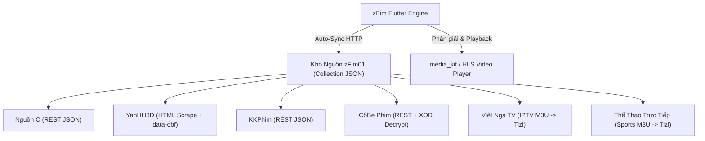

# 📑 TÀI LIỆU ĐẶC TẢ KỸ THUẬT: QUY CHUẨN TẠO NGUỒN PHIM CHO KHO NGUỒN zFim (zFim Addon JSON v1 Specification)

> **Mã đặc tả:** `ZFIM-SPEC-ADDON-V1`  
> **Phiên bản Schema:** `zfim/addon-json/v1`  
> **Cập nhật:** 2026-11-05  
> **Kho nguồn chuẩn Git:** `https://github.com/magicxlll/zfim-default-sources.git`  
> **Định dạng Kho:** `zFim01.json` (Collection v1.4.1+)

---

## MỤC LỤC
1. [Triết Lý Kiến Trúc & Tổng Quan Schema](#1-triết-lý-kiến-trúc--tổng-quan-schema)
2. [Đặc Tả Chi Tiết 3 Kiểu Nguồn Cốt Lõi](#2-đặc-tả-chi-tiết-3-kiểu-nguồn-cốt-lõi)
   - 2.1. Nguồn REST API JSON (`json`)
   - 2.2. Nguồn Web Scraping HTML (`scrape`)
   - 2.3. Nguồn Truyền Hình & Thể Thao M3U (`m3u`)
3. [Thư Viện Các Case Đặc Biệt & Chiến Lược Bóc Tách](#3-thư-viện-các-case-đặc-biệt--chiến-lược-bóc-tách)
   - Case 1: Trình phát giả lập M3U8 bọc chuỗi mã hoá `data-obf` (JWPlayer / Base64)
   - Case 2: Luồng stream mã hoá nhị phân XOR / Hex Decryption
   - Case 3: Nguồn web đổi tên miền liên tục (Dynamic Domain Auto-Resolution)
   - Case 4: Cơ chế chống Hotlinking luồng phát (Referer & User-Agent Strict Binding)
   - Case 5: Trang web Single Page App (SPA / Next.js / Hydration) & Cloudflare Turnstile
   - Case 6: Nguồn Kênh Truyền Hình & Thể Thao Trực Tiếp dành riêng cho Tab Tizi
4. [Cẩm Nang Bài Học Kinh Nghiệm & Cách Tránh Lỗi Thường Gặp](#4-cẩm-nang-bài-học-kinh-nghiệm--cách-tránh-lỗi-thường-gặp)
   - Bài học 1: Xử lý triệt để lỗi Poster bị méo / kéo dãn tỉ lệ (2:3 vs 16:9)
   - Bài học 2: Khắc phục lỗi thiếu Catalog / Phân trang (`{page}`) không hoạt động
   - Bài học 3: Lỗi định tuyến tập phim (`{slug}` vs `{episode}` vs `targetId`)
   - Bài học 4: Tránh sập trình phát khi gặp Stream giả dạng `.m3u8`
   - Bài học 5: Quy chuẩn đồng bộ kho nguồn (Clean Platform & Git Auto-Sync Pipeline)
5. [Master Prompt Cho AI Agent Tự Động Tạo Nguồn Từ Web Bất Kỳ](#5-master-prompt-cho-ai-agent-tự-động-tạo-nguồn-từ-web-bất-kỳ)

---

## 1. Triết Lý Kiến Trúc & Tổng Quan Schema

### 1.1. Triết lý "Clean Platform" (Nền tảng sạch)
* **App zFim hoàn toàn trắng nguồn mặc định:** Không nhúng cứng (hard-code) API hay link web của bất kỳ bên thứ ba nào vào mã nguồn Flutter.
* **Nạp động 100% qua Kho Nguồn (Repository Collection):** Toàn bộ metadata, danh mục, quy tắc bóc tách và stream regex được nạp động từ file JSON `zFim01.json` trên Git công khai.
* **Tự động đồng bộ ngầm (Auto-Sync):** Khi người dùng mở app hoặc vào giao diện Quản lý nguồn, app tự động kiểm tra `version` của Kho nguồn. Nếu kho được nâng cấp (ví dụ `1.4.0` -> `1.4.1`), toàn bộ addon sẽ được cập nhật âm thầm trong tích tắc.

### 1.2. Phân Cấp Định Dạng JSON
Hệ thống zFim hỗ trợ 2 cấu trúc JSON:
1. **Single Addon (`kind: "single"`):** File JSON định nghĩa duy nhất 1 nguồn (dùng để import lẻ hoặc test riêng).
2. **Collection Repository (`kind: "collection"`):** File JSON chứa mảng `addons: [...]` đại diện cho cả một Kho nguồn tổng hợp (như `zFim01.json`).



---

## 2. Đặc Tả Chi Tiết 3 Kiểu Nguồn Cốt Lõi

Mọi Addon đều phải có phần Header chuẩn:
```json
{
  "$schema": "zfim/addon-json/v1",
  "kind": "single",
  "id": "ma-nguon-viet-thuong-khong-dau",
  "name": "Tên Hiển Thị Của Nguồn",
  "version": "1.0.0",
  "description": "Mô tả nguồn phim, chất lượng và nội dung đặc trưng",
  "logo": "https://domain.com/icon.png",
  "base": "https://domain.com",
  "headers": {
    "User-Agent": "Mozilla/5.0 (Windows NT 10.0; Win64; x64) AppleWebKit/537.36 (KHTML, like Gecko) Chrome/124.0.0.0 Safari/537.36",
    "Referer": "https://domain.com/"
  },
  "types": ["series", "movie"]
}
```

---

### 2.1. Nguồn REST API JSON (`json`)
Dùng khi website cung cấp API trả về JSON chuẩn (phổ biến ở các kho phim lớn như NguonC, KKPhim, VSMOV, Phim E).

```json
{
  "json": {
    "list": {
      "path": "/api/films/phim-moi-cap-nhat?page={page}",
      "items": "items",
      "map": {
        "id": "slug",
        "name": "name",
        "poster": "thumb_url",
        "background": "poster_url",
        "description": "content"
      }
    },
    "meta": {
      "path": "/api/film/{id}",
      "map": {
        "name": "movie.name",
        "poster": "movie.thumb_url",
        "background": "movie.poster_url",
        "description": "movie.content",
        "episodes": "movie.episodes"
      }
    },
    "streams": {
      "path": "{embed_url}",
      "regexes": [
        "https?://[^\"'\\s]+\\.m3u8",
        "https?://[^\"'\\s]+\\.mp4"
      ]
    }
  }
}
```
* **Quy tắc mapping JSON dot-notation:**
  * Có thể truy cập thuộc tính lồng nhau bằng dấu chấm: `movie.details.director`, `data.items`.
  * Biến `{id}` hoặc `{slug}` được app tự động thay bằng mã phim khi gọi `getMeta`.
  * Biến `{page}` trong `list.path` được app tự động tăng khi cuộn trang (vô tận / pagination).

---

### 2.2. Nguồn Web Scraping HTML (`scrape`)
Dùng cho các trang web phim truyền thống trả về HTML (như YanHH3D, HH3D, AnimeHay).

```json
{
  "scrape": {
    "list": {
      "endpoint": "/moi-cap-nhat?page={page}",
      "item": ".film-item, .flw-item",
      "map": {
        "id": "a.film-poster-ahref @href",
        "name": "h3.film-name a @text",
        "poster": "img.film-poster-img @data-src",
        "description": ".film-desc @text"
      }
    },
    "meta": {
      "endpoint": "/{slug}",
      "map": {
        "name": "h1.film-name @text",
        "poster": "img.film-poster-img @data-src",
        "description": ".film-description .text @text",
        "videos": {
          "item": ".ep-item, a.ep-btn",
          "map": {
            "title": "@title",
            "id": "@href"
          }
        }
      }
    },
    "streams": {
      "endpoint": "/{slug}",
      "candidates": {
        "selector": "a.btn3dsv, a.btn-play, iframe, video, source",
        "attr": "data-src",
        "label": "@name"
      }
    }
  },
  "streamFilters": {
    "blocklistHosts": ["facebook.com", "google.com", "quangcao.net"],
    "bannedTerms": ["banner", "promo", "quangcao"],
    "allowedIndicators": [".m3u8", ".mp4", "stream", "video"]
  },
  "streamUnwrapping": [
    "data-obf",
    "direct-m3u8"
  ]
}
```
* **Cú pháp trích xuất Scrape:**
  * `CSS_SELECTOR @attr`: Lấy giá trị thuộc tính (ví dụ `img @src`, `a @href`, `div @data-src`).
  * `CSS_SELECTOR @text`: Lấy nội dung text hiển thị bên trong thẻ.
  * Nếu không có `@attr`, mặc định là `@text`.

---

### 2.3. Nguồn Truyền Hình & Thể Thao M3U (`m3u`)
Dành riêng cho tính năng **Tizi (Live TV & Trực Tiếp Thể Thao)** của zFim:

```json
{
  "m3u": {
    "url": "https://raw.githubusercontent.com/user/repo/main/vietnam.m3u",
    "cacheMinutes": 180,
    "defaultHeaders": {
      "User-Agent": "VLC/3.0.18 LibVLC/3.0.18",
      "Referer": "https://tivigoc.com/"
    },
    "includeGroups": ["VTV", "HTV", "VTC", "Thể Thao"],
    "excludeGroups": ["18+", "Quảng Cáo", "Test"]
  }
}
```
* **Tích hợp Tizi:** App tự động nhận diện `m3u`, phân nhóm theo `group-title`, trích xuất `tvg-logo` và đẩy trực tiếp vào giao diện Dock xem TV + danh sách kênh dạng lưới phẳng thông minh.

---

## 3. Thư Viện Các Case Đặc Biệt & Chiến Lược Bóc Tách

### Case 1: Trình phát giả lập M3U8 bọc chuỗi mã hoá `data-obf` (JWPlayer / Base64)
* **Website điển hình:** `yanhh3d.de`, `hh3d.com`, các web hoạt hình 3D dùng JWPlayer embed.
* **Đặc điểm nhận diện:** 
  * Link server trong HTML có đuôi `.m3u8` (ví dụ `https://scontent-sin2-xx.streamrpt1.site/.../038221b5.m3u8`).
  * Khi tải URL này về bằng `curl`, kết quả không phải là playlist video mà là một **trang HTML**:
    ```html
    <div id="player" data-obf="eyJzVSI6ICJ...iLCAicFUiOiAiaHR0cHM6Ly8...In0="></div>
    ```
* **Chiến lược bóc tách:**
  1. Addon khai báo: `"streamUnwrapping": ["data-obf", "direct-m3u8"]`.
  2. Engine zFim sẽ fetch trang candidate, tìm thuộc tính `data-obf`, giải mã Base64 sang chuỗi JSON.
  3. Trích xuất trường `pU` (Plain URL) kết thúc bằng `/stream-plain?t=...` chính là M3U8 master playlist trực tiếp.
  4. Nếu có AES-GCM (`sU`), engine sẽ dùng fallback `pU` để phát mượt mà không cần Webview.

---

### Case 2: Luồng stream mã hoá nhị phân XOR / Hex Decryption
* **Website điển hình:** `cobephim.fun` (hệ thống API `darkbytes.xyz`).
* **Đặc điểm nhận diện:**
  * API chi tiết tập trả về:
    ```json
    { "encrypted_url": "7b2f6d3a0109..." }
    ```
* **Chiến lược bóc tách:**
  1. Sử dụng thuật toán Hex XOR Decrypt với khóa bí mật của hệ thống (`mySecretKey2024`).
  2. Chuỗi sau giải mã sẽ trỏ về player trung gian `streamc.xyz` hoặc file M3U8 trực tiếp.
  3. `StreamUnwrapper.resolveStreamc()` tự động bóc tách link direct M3U8 và trả về player kèm header.

---

### Case 3: Nguồn web đổi tên miền liên tục (Dynamic Domain Auto-Resolution)
* **Website điển hình:** Các website phim lậu thường xuyên bị nhà mạng chặn tên miền (`.plus` -> `.de` -> `.is`).
* **Chiến lược giải quyết:**
  * Cấu hình trường `dynamicDomainUrl` trong Addon JSON:
    ```json
    "base": "https://yanhh3d.de",
    "dynamicDomainUrl": "https://bit.ly/yanhh3d"
    ```
  * Hoặc trỏ vào raw file trên GitHub/jsdelivr: `https://fastly.jsdelivr.net/gh/Datj0000/domain@main/yanhh3d.txt`.
  * **Cơ chế zFim Engine:** Khi app gặp lỗi kết nối hoặc khởi động, engine sẽ tự động gửi request `HEAD` tới `dynamicDomainUrl` để bám theo redirect 301/302, tự cập nhật lại `spec.base` ngay trong bộ nhớ runtime mà không cần cập nhật code app!

---

### Case 4: Cơ chế chống Hotlinking luồng phát (Referer & User-Agent Strict Binding)
* **Website điển hình:** Hầu hết các CDN streaming chuyên dụng (`streamrpt1.site`, `fbcdn`, `fastly`, `mcloud`).
* **Hiện tượng:** Nếu player gửi request lấy chunk video `.ts` mà không có Referer hoặc Referer sai, CDN sẽ phản hồi **HTTP 403 Forbidden**.
* **Giải pháp:**
  * Luôn khai báo `headers` đầy đủ ở cấp gốc của Addon:
    ```json
    "headers": {
      "User-Agent": "Mozilla/5.0 (Windows NT 10.0; Win64; x64)...",
      "Referer": "https://yanhh3d.de/"
    }
    ```
  * Engine của zFim sẽ tự động chuyển tiếp cặp header này xuống trình phát `media_kit` (VideoPlayer) cho cả file master `.m3u8` lẫn từng chunk phân đoạn `.ts`.

---

### Case 5: Trang web Single Page App (SPA / Next.js / Hydration) & Cloudflare Turnstile
* **Website điển hình:** `phimmoic.bz`, `motchilln.fm`, `hoathinh3d.pw`.
* **Hiện tượng:** Toàn bộ HTML tĩnh chỉ chứa vỏ `BAILOUT_TO_CLIENT_SIDE_RENDERING` hoặc token Cloudflare Challenge; link video được render bằng Javascript phức tạp ở phía client.
* **Tiêu chuẩn minh bạch zFim (Transparency Standard):**
  * **Tuyệt đối không bịa CSS selector giả mạo.**
  * Khai báo rõ ràng trạng thái không hỗ trợ tĩnh để app kích hoạt cơ chế Webview Fallback:
    ```json
    {
      "id": "motchill",
      "name": "Motchill",
      "unsupported": "needs-js",
      "reason": "Next.js dynamic client hydration required to render video player"
    }
    ```

---

### Case 6: Nguồn Kênh Truyền Hình & Thể Thao Trực Tiếp dành riêng cho Tab Tizi
* **Website điển hình:** Kênh truyền hình quốc gia, trực tiếp bóng đá Ngoại Hạng Anh, C1.
* **Quy chuẩn định danh Tizi:**
  * Bắt buộc sử dụng block `"m3u"`.
  * Khai báo danh mục theo nhóm kênh: VTV, HTV, Thể Thao, Quốc Tế.
  * Tối ưu `cacheMinutes: 180` để app không tải lại file m3u quá nhiều lần gây nghẽn mạng.

---

## 4. Cẩm Nang Bài Học Kinh Nghiệm & Cách Tránh Lỗi Thường Gặp

```mermaid
flowchart LR
    A[Lỗi Thường Gặp] --> B[1. Méo Poster 16:9 ép 2:3]
    A --> C[2. Thiếu Catalog / Pagination]
    A --> D[3. Nhầm lẫn {slug} tập phim]
    A --> E[4. Stream M3U8 trả về HTML]
    A --> F[5. Lệch version Kho nguồn]
```

### Bài học 1: Xử lý triệt để lỗi Poster bị méo / kéo dãn tỉ lệ (2:3 vs 16:9)
* **Nguyên nhân:** Thẻ card phim trong zFim thiết kế theo tỉ lệ dọc chuẩn điện ảnh **2:3**. Một số nguồn chỉ có ảnh thumbnail video dạng ngang **16:9** (hoặc đặt ngược `thumb_url` là ảnh ngang, `poster_url` là ảnh dọc). Nếu nạp nhầm ảnh ngang vào khung dọc, poster sẽ bị kéo dãn biến dạng.
* **Cách khắc phục:**
  1. Kiểm tra kỹ URL ảnh từ API:
     * Ví dụ ở **KKPhim**: `poster_url` là ảnh dọc (2:3) -> map vào `poster`. `thumb_url` là ảnh ngang (16:9) -> map vào `background`.
     * Ở **NguonC**: `thumb_url` lại là ảnh dọc (2:3) -> map vào `poster`. `poster_url` là ảnh ngang (16:9) -> map vào `background`.
  2. **Giải pháp TMDB Enrichment:** Nếu nguồn chỉ có duy nhất ảnh ngang xấu (như CôBe Phim), hệ thống zFim đã tích hợp sẵn cơ chế tìm kiếm TMDB tự động qua tên phim để bù poster 2:3 độ phân giải 4K sắc nét.

---

### Bài học 2: Khắc phục lỗi thiếu Catalog / Phân trang (`{page}`) không hoạt động
* **Nguyên nhân:** 
  * Chỉ khai báo 1 catalog duy nhất khiến app hiển thị nghèo nàn.
  * Trong URL endpoint quên không để placeholder `{page}` (ví dụ viết cứng `?page=1`). Khi người dùng lướt xuống đáy, app không biết cách yêu cầu trang tiếp theo.
* **Cách khắc phục:**
  * Bắt buộc mọi catalog đều phải chứa `{page}`:
    ```json
    "endpoint": "/api/films/danh-sach/phim-bo?page={page}"
    ```
  * Khai báo phong phú tối thiểu 4-6 danh mục chính: *Mới Cập Nhật, Phim Bộ, Phim Lẻ, Hoạt Hình, Thể Loại Hot*.

---

### Bài học 3: Lỗi định tuyến tập phim (`{slug}` vs `{episode}` vs `targetId`)
* **Nguyên nhân (Sự cố Già Thiên Tập 188):**
  * Nguồn phim có link chi tiết là `/gia-thien`, nhưng link xem tập 188 là `/gia-thien/tap-188`.
  * Nếu khai báo `endpoint: "/{slug}"` nhưng engine thay `{slug}` bằng ID phim gốc (`gia-thien`), app sẽ tải lại trang tổng quan và không thấy server phát nào.
* **Cách khắc phục:**
  * Luôn đảm bảo block `streams.endpoint` được cấu hình linh hoạt:
    ```json
    "streams": {
      "endpoint": "/{slug}",
      "candidates": {
        "selector": "a.btn3dsv, a.btn-play, iframe",
        "attr": "data-src"
      }
    }
    ```
  * `targetId` trong engine sẽ ưu tiên lấy `videoId` (slug của tập phim) trước khi fallback về `id` của phim.

---

### Bài học 4: Tránh sập trình phát khi gặp Stream giả dạng `.m3u8`
* **Nguyên nhân:** CDN trả về mã HTTP 200 nhưng nội dung là trang HTML (chứa JWPlayer mã hoá `data-obf` hoặc thông báo lỗi Javascript). Nếu đưa chuỗi HTML này vào trình phát media, trình phát sẽ crash hoặc đứng hình đen thui.
* **Cách khắc phục:**
  * Luôn kiểm tra nội dung phản hồi: nếu nội dung không bắt đầu bằng `#EXTM3U`, phải chuyển tiếp qua bộ bóc tách `StreamUnwrapper` để giải mã tìm link stream thật trước khi nạp vào trình phát.

---

### Bài học 5: Quy chuẩn đồng bộ kho nguồn (Clean Platform & Git Auto-Sync Pipeline)
* **Quy tắc vàng:** Không sửa nguồn trực tiếp trong mã Flutter. Mọi thao tác bổ sung / chỉnh sửa nguồn đều thực hiện qua quy trình 4 bước chuẩn:
  1. Chỉnh sửa / thêm file addon trong `zfim-default-sources/addons/<source>.json`.
  2. Cập nhật vào kho tổng hợp `zfim-default-sources/zFim01.json` và **BẮT BUỘC NÂNG VERSION** (ví dụ `1.4.1` -> `1.4.2`).
  3. Commit và Push lên GitHub repo `https://github.com/magicxlll/zfim-default-sources.git`.
  4. Đồng bộ file sang `zApp-dist/zFim01.json` và gọi lệnh Purge cache jsDelivr:
     ```sh
     curl -s https://purge.jsdelivr.net/gh/magicxlll/zfim-default-sources@main/zFim01.json
     ```
  * Khi mở app, `SourceRegistry` của zFim sẽ tự động so sánh số version mới và cập nhật sạch sẽ toàn bộ nguồn về máy người dùng!

---

## 5. Master Prompt Cho AI Agent Tự Động Tạo Nguồn Từ Web Bất Kỳ

> Dưới đây là Prompt hoàn chỉnh để bạn cung cấp cho bất kỳ AI Agent nào (Claude, Gemini, ChatGPT, Codex, Antigravity) để Agent tự động khảo sát, bóc tách và viết ra file JSON Addon chuẩn 100% cho zFim.

````markdown
# NHIỆM VỤ: KHẢO SÁT & BÓC TÁCH NGUỒN PHIM MỚI CHO KHO NGUỒN zFim (zFim Addon JSON v1)

Bạn là một Kỹ Sư Công Nghệ Reverse-Engineering & Chuyên Gia Addon zFim. Nhiệm vụ của bạn là phân tích trang web phim được chỉ định và tạo ra một file cấu hình Addon JSON hợp lệ tuân thủ nghiêm ngặt chuẩn `zfim/addon-json/v1`.

## ĐẦU VÀO CỦA BẠN:
- Tên nguồn / Website URL mục tiêu (Ví dụ: https://example-movie.com)

---

## BỘ QUY TẮC THI HÀNH 6 BƯỚC BẮT BUỘC:

### BƯỚC 1: KHẢO SÁT MẠNG & PHÂN LOẠI KIỂU NGUỒN (NETWORK AUDIT)
1. Dùng curl / DevTools kiểm tra trang chủ và một phim cụ thể trên trang web mục tiêu:
   - Trang có cung cấp REST API JSON ngầm không? (Kiểm tra tab Network xem có gọi `/api/...` hay không).
   - Nếu CÓ API JSON -> Phân loại vào kiểu `"json"` (REST API Addon).
   - Nếu trả về HTML truyền thống có dữ liệu phim tĩnh -> Phân loại vào kiểu `"scrape"` (HTML Scraper Addon).
   - Nếu là danh sách kênh truyền hình / stream thể thao trực tiếp -> Phân loại vào kiểu `"m3u"`.
   - Nếu là Next.js hydration tĩnh (`BAILOUT_TO_CLIENT_SIDE_RENDERING`) hoặc vướng Cloudflare Turnstile bot protection -> Trả về `"unsupported": "needs-js"`. Tuyệt đối không bịa CSS selector giả!

### BƯỚC 2: XÁC ĐỊNH DANH MỤC PHIM & PHÂN TRANG (CATALOGS & PAGINATION)
1. Tìm các chuyên mục chính: Mới Cập Nhật, Phim Bộ, Phim Lẻ, Hoạt Hình, Thể Loại.
2. Kiểm tra tham số phân trang: Tìm xem trang web chuyển trang qua query param nào (`?page={page}`, `?p={page}`, `/trang-{page}`).
3. Bắt buộc đặt placeholder `{page}` trong `endpoint` để app hỗ trợ cuộn trang vô tận.

### BƯỚC 3: TRÍCH XUẤT CẤU TRÚC PHIM & TẬP PHIM (METADATA & EPISODES)
1. **Kiểm tra tỉ lệ Poster:** 
   - Xác định rõ trường nào là ảnh dọc chuẩn 2:3 (gán vào `poster`), trường nào là ảnh bìa ngang 16:9 (gán vào `background`). Tuyệt đối không đảo lộn để tránh kéo dãn ảnh trên giao diện app.
2. **Cấu trúc tập phim:**
   - Với HTML: Tìm selector chứa danh sách tập (`.ep-item`, `a.ep-btn`) với `@title` và `@href`.
   - Với REST: Map đúng mảng episodes và server phát.

### BƯỚC 4: GIẢI MÃ STREAM CANDIDATES & CHỐNG HOTLINKING (STREAMS & ANTI-HOTLINK)
1. Kiểm tra cách server trả về video:
   - Có đuôi `.m3u8` hoặc `.mp4` trực tiếp không?
   - Có sử dụng JWPlayer nhúng chuỗi `data-obf` Base64 không? Nếu có, thêm `"streamUnwrapping": ["data-obf", "direct-m3u8"]`.
   - Có dùng mã hoá XOR (như darkbytes) không?
2. Bắt buộc cấu hình đầy đủ `headers`:
   ```json
   "headers": {
     "User-Agent": "Mozilla/5.0 (Windows NT 10.0; Win64; x64) AppleWebKit/537.36...",
     "Referer": "https://domain-muc-tieu.com/"
   }
   ```

### BƯỚC 5: TẠO FILE CẤU HÌNH JSON CHUẨN
Tạo file JSON tuân thủ đầy đủ schema sau:
```json
{
  "$schema": "zfim/addon-json/v1",
  "kind": "single",
  "id": "slug-nguon",
  "name": "Tên Nguồn",
  "version": "1.0.0",
  "description": "Mô tả chất lượng phim",
  "logo": "https://.../logo.png",
  "base": "https://domain-muc-tieu.com",
  "headers": {
    "User-Agent": "Mozilla/5.0...",
    "Referer": "https://domain-muc-tieu.com/"
  },
  "types": ["series", "movie"],
  "catalogs": [
    {
      "id": "moi-cap-nhat",
      "type": "series",
      "name": "Mới Cập Nhật",
      "endpoint": "/danh-sach/phim-moi?page={page}"
    }
  ],
  ... (chọn block scrape, json, hoặc m3u tương ứng)
}
```

### BƯỚC 6: KIỂM THỬ GIẢ LẬP (VERIFICATION CHECKLIST)
Trước khi xuất kết quả cuối cùng, tự đối soát:
- [ ] Placeholder `{page}` đã có trong mọi catalog?
- [ ] Poster ảnh dọc 2:3 không bị lẫn với ảnh ngang 16:9?
- [ ] Endpoint stream `{slug}` nhận đúng slug tập phim thay vì ID phim gốc?
- [ ] Header `Referer` đã trỏ đúng domain gốc để tránh lỗi HTTP 403 khi tải video chunk?
- [ ] Cú pháp JSON chuẩn 100%, không thiếu dấu ngoặc hay thừa dấu phẩy?

---
XUẤT KẾT QUẢ:
1. Bản phân tích kỹ thuật tóm tắt (Kiểu nguồn, Cơ chế stream, Thách thức bảo mật).
2. Toàn bộ nội dung file JSON cấu hình Addon hoàn chỉnh, sẵn sàng import vào zFim.
````
