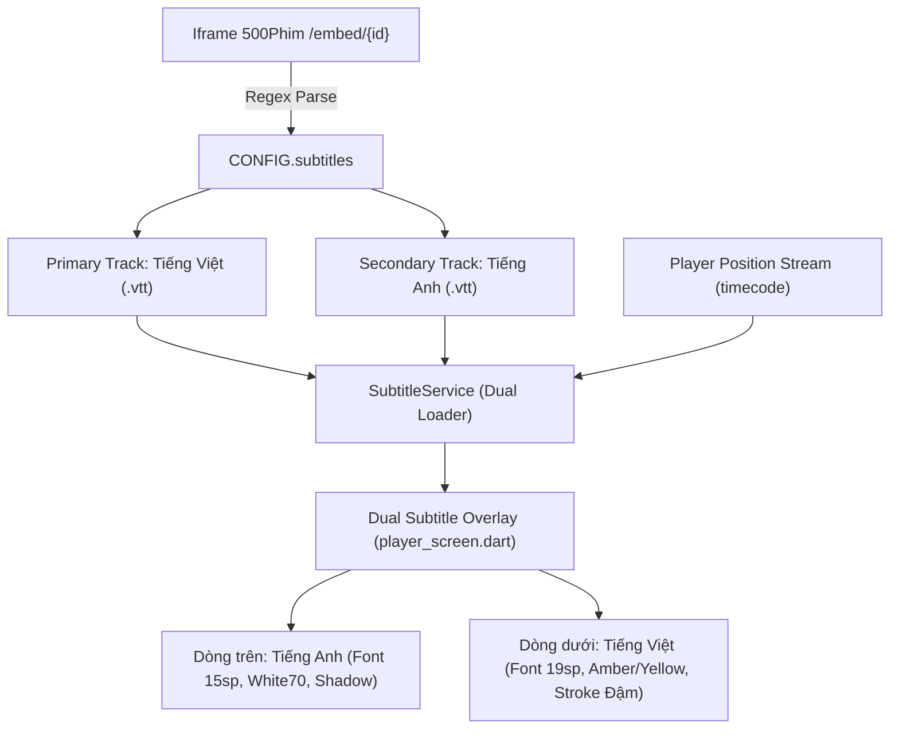

# 📋 ĐẶC TẢ ĐIỀU CHỈNH MÃ NGUỒN APP zFim TỐI ƯU HÓA CHO CÁC NGUỒN KHO zFim01
> **Mã đặc tả:** `ZFIM-SPEC-ENGINE-ADAPTATION-V1`  
> **Dành cho:** AI Agent / Kỹ sư phụ trách mã nguồn Flutter của dự án zFim (`zfim_flutter/`)  
> **Kho nguồn tương ứng:** `zFim01.json` (Phiên bản kho hiện hành: **v1.5.3**)  
> **Ngày cập nhật:** 2026-11-08  

---

## 📌 MỤC ĐÍCH TÀI LIỆU
Tài liệu này tổng hợp toàn bộ các phát hiện kỹ thuật, hiện trạng không tương thích và đặc tả chi tiết các đoạn mã cần điều chỉnh trong ứng dụng Flutter `zfim_flutter/` để giúp app khai thác tối đa sức mạnh của các nguồn phim mới được bổ sung vào kho `zFim01`.

Các kỹ sư/AI Agent phụ trách app Flutter chỉ cần đọc tài liệu này và thực hiện cập nhật mã nguồn theo đúng các mục dưới đây.

---

## 📑 MỤC LỤC
1. [Nguồn 1: VieFlix (`vieflix`) - Đặc Tả Nâng Cấp Engine](#1-nguồn-1-vieflix-vieflix---đặc-tả-nâng-cấp-engine)
2. [Nguồn 2: XiaoPhim (`xiaofilm`) - Đặc Tả Nâng Cấp Engine](#2-nguồn-2-xiaophim-xiaofilm---đặc-tả-nâng-cấp-engine)
3. [Nguồn 3: 500Phim 4K (`500phim`) - Đặc Tả Nâng Cấp Engine & Trình Phát Phụ Đề Song Ngữ](#3-nguồn-3-500phim-4k-500phim---đặc-tả-nâng-cấp-engine--trình-phát-phụ-đề-song-ngữ)
4. [Bảng Kiểm Thử Đối Soát (Verification Matrix)](#4-bảng-kiểm-thử-đối-soát-verification-matrix)

---

## 1. Nguồn 1: VieFlix (`vieflix`) - Đặc Tả Nâng Cấp Engine

### 1.1. Tổng quan nguồn
* **ID Addon:** `vieflix`
* **Loại nguồn:** REST API JSON (`json`)
* **Tên miền hoạt động:** `https://vieflix.buzz`
* **Tên miền động gốc (Landing Page):** `https://www.vieflix.com/` (cấu hình tại `https://www.vieflix.com/constant.js`)
* **Quy mô:** Hơn 30.470 phim, tích hợp 5 Server phát lớn (`KKPhim`, `NguonC`, `OnFlix`, `ViCDN`, `VSPhim`), poster dọc 2:3 chuẩn điện ảnh sắc nét (`posterUrl`).

### 1.2. Vấn đề kỹ thuật trong Engine hiện tại
1. **Lỗi phân giải tập phim đa server lồng nhau:**
   * Trong file `zfim_flutter/lib/addons/json/json_rest_addon.dart` (hàm `parseMetaJson`, dòng 533-575):
   * Engine hiện tại giả định mảng tập phim nằm trực tiếp trong `epGroup['server_data']` hoặc `epGroup['items']` (chuẩn KKPhim / NguonC).
   * Tuy nhiên, API chi tiết `/api/movies/{slug}` của VieFlix có cấu trúc lồng 2 cấp:
     ```json
     "sources": [
       {
         "serverName": "KKPhim",
         "serverKey": "kkphim",
         "languages": [
           {
             "name": "Vietsub",
             "slug": "vietsub",
             "episodes": [
               {
                 "name": "Tập 1",
                 "slug": "tap-1",
                 "linkM3u8": "https://v7.kkphimplayer7.com/20260819/UXIzsB0W/index.m3u8",
                 "linkEmbed": "https://player.phimapi.com/player/?url=..."
               }
             ]
           }
         ]
       }
     ]
     ```
   * Do `epGroup['server_data']` và `items` đều trả về `null`, engine hiện tại bỏ qua mảng tập thật và chỉ sinh 1 tập giả rỗng.
2. **Thiếu hỗ trợ Dynamic Domain trong `JsonRestAddon`:**
   * `JsonRestAddon` chưa có hàm `_initDynamicDomain()` và `_refreshDynamicDomain()`.
   * Thêm vào đó, trang `https://www.vieflix.com/` trả về HTTP 200 kèm file Javascript `constant.js` (`TARGET_DOMAIN: "https://vieflix.buzz"`), không dùng mã chuyển hướng HTTP 301/302. Cơ chế dò redirect của engine cần mở rộng thêm khả năng bóc tách regex.

### 1.3. Hướng dẫn sửa code chi tiết cho `json_rest_addon.dart`

**File:** `zfim_flutter/lib/addons/json/json_rest_addon.dart`

#### Bước 1: Bổ sung nhánh bóc tách đa server (`languages -> episodes`)
Tại hàm `parseMetaJson`, tìm khối vòng lặp `for (final epGroup in rawEpisodes)`:

```dart
// [THÊM VÀO ĐẦU VÒNG LẶP for (final epGroup in rawEpisodes)]
if (epGroup is Map<String, dynamic>) {
  final languages = epGroup['languages'] as List<dynamic>?;
  if (languages != null && languages.isNotEmpty) {
    final sName = (epGroup['serverName'] ?? epGroup['server_name'] ?? 'Server').toString().trim();
    for (final lang in languages) {
      if (lang is! Map<String, dynamic>) continue;
      final langName = (lang['name'] ?? '').toString().trim();
      final fullServerName = langName.isNotEmpty ? '$sName ($langName)' : sName;
      final eps = lang['episodes'] as List<dynamic>?;
      if (eps != null) {
        for (final item in eps) {
          if (item is Map<String, dynamic>) {
            final epName = (item['name'] ?? '$epCounter').toString();
            final epSlug = (item['slug'] ?? 'tap-$epCounter').toString();
            final linkM3u8 = (item['linkM3u8'] ?? item['link_m3u8'] ?? item['m3u8'] ?? '').toString();
            final linkEmbed = (item['linkEmbed'] ?? item['link_embed'] ?? item['embed'] ?? '').toString();
            final playId = linkM3u8.isNotEmpty
                ? linkM3u8
                : (linkEmbed.isNotEmpty ? linkEmbed : '$id/$epSlug');

            final cleanEp = epName.replaceAll(RegExp(r'^(?:tập\s*)+', caseSensitive: false), '').trim();
            videos.add(MetaVideo(
              id: playId,
              title: cleanEp.isNotEmpty ? 'Tập $cleanEp' : 'Tập $epName',
              episode: int.tryParse(epName.replaceAll(RegExp(r'[^0-9]'), '')) ?? epCounter,
              season: 1,
              server: fullServerName,
              serverId: fullServerName,
            ));
            epCounter++;
          }
        }
      }
    }
    continue;
  }
}
```

#### Bước 2: Bổ sung Dynamic Domain Resolution cho `JsonRestAddon`
Kế thừa cơ chế `_initDynamicDomain()` và `_refreshDynamicDomain()` từ `JsonScrapeAddon`, đồng thời hỗ trợ đọc biến `TARGET_DOMAIN` trong file JS / HTML landing page:

```dart
// Khi response.statusCode == 200, kiểm tra chuỗi regex:
final body = fullRes.body;
final jsMatch = RegExp(r'''TARGET_DOMAIN\s*:\s*["\'](https?://[^"\']+)["\']''').firstMatch(body) ??
                RegExp(r'''id=["\']domainInput["\'][^>]*value=["\'](https?://[^"\']+)["\']''').firstMatch(body);
if (jsMatch != null) {
  targetDomain = jsMatch.group(1);
}
```

---

## 2. Nguồn 2: XiaoPhim (`xiaofilm`) - Đặc Tả Nâng Cấp Engine

### 2.1. Tổng quan nguồn
* **ID Addon:** `xiaofilm`
* **Loại nguồn:** Web Scraping HTML (`scrape`)
* **Tên miền hoạt động:** `https://xiaofilm.online`
* **Tên miền động qua Cloudflare Worker:** `https://api1.xiaofilm.workers.dev/config.json`
* **Quy mô:** Tuyển tập hơn 10.000+ phim bộ, 10.000+ phim lẻ chiếu rạp, chuyên mục 4K Ultra HD, Anime Vietsub, Vũ trụ Marvel, Phim Châu Tinh Trì, Top TMDB.
* **Đặc tính luồng phát:** Luồng HLS Master Playlist `.m3u8` trực tiếp tốc độ cao trên CDN `v8.streamvsmov.com`, hỗ trợ đầy đủ CORS (`access-control-allow-origin: *`).

### 2.2. Vấn đề kỹ thuật trong Engine hiện tại
1. **Dữ liệu tập phim & Stream nhúng trong React Server Component (Next.js RSC):**
   * Trong file `zfim_flutter/lib/addons/json/json_scrape_addon.dart`:
   * Khi người dùng xem một phim (ví dụ `/phim/36-ke-doat-mang`), nút xem phim trỏ sang `/xem-phim/36-ke-doat-mang`.
   * Tuy nhiên, trang `/xem-phim/{slug}` không render danh sách tập bằng thẻ HTML truyền thống (`<a>` hay `<button>`) mà truyền toàn bộ dữ liệu qua script payload Next.js:
     ```javascript
     self.__next_f.push([1, "...\"servers\":[{\"server_name\":\"Vietsub_1\",\"source\":\"vsmov\",\"episodes\":[{\"ep_name\":\"1\",\"ep_slug\":\"tap-1\",\"link_m3u8\":\"https://v8.streamvsmov.com/video/.../master.m3u8\"}]}]..."])
     ```
   * Engine hiện tại do không tìm thấy thẻ DOM chứa link video nên rơi vào fallback WebView `Trình phát VIP Web`.
2. **Cơ chế phân giải tên miền từ Cloudflare Worker:**
   * URL `https://api1.xiaofilm.workers.dev/config.json` trả về JSON:
     ```json
     {
       "version": 1,
       "server_origin": "https://xiaofilm.online",
       "refresh_seconds": 21600
     }
     ```
   * Engine cần hỗ trợ đọc trực tiếp trường `server_origin` này khi cập nhật domain động.

### 2.3. Hướng dẫn sửa code chi tiết cho `json_scrape_addon.dart`

**File:** `zfim_flutter/lib/addons/json/json_scrape_addon.dart`

#### Bước 1: Trích xuất tập phim từ Next.js RSC Payload trong `getMeta`
Tại hàm `getMeta` (sau khi tải HTML trang chi tiết hoặc trang xem phim), nếu `detail.videos.length <= 1`:

```dart
// [HỖ TRỢ NEXT.JS RSC EPISODES CHO XIAOPHIM]
if (html.contains('__next_f') && (html.contains('"servers"') || html.contains('"episodes"'))) {
  try {
    // Trích xuất toàn bộ chuỗi RSC được đẩy vào self.__next_f
    final rscMatches = RegExp(r'self\.__next_f\.push\(\[1,\s*"([\s\S]*?)"\]\)').allMatches(html);
    final buffer = StringBuffer();
    for (final m in rscMatches) {
      final chunk = m.group(1) ?? '';
      buffer.write(chunk.replaceAll(r'\"', '"').replaceAll(r'\\', r'\'));
    }
    final rscPayload = buffer.toString();

    // Tìm block "servers":[...]
    final serversRegex = RegExp(r'"servers"\s*:\s*(\[\{[\s\S]*?\}\])\s*(?:,\s*"|[}\]])');
    final sMatch = serversRegex.firstMatch(rscPayload);
    if (sMatch != null) {
      final serversList = json.decode(sMatch.group(1)!) as List<dynamic>;
      final rscVideos = <MetaVideo>[];
      int epCounter = 1;
      for (final s in serversList) {
        if (s is! Map<String, dynamic>) continue;
        final sName = (s['server_name'] ?? 'Server VIP').toString();
        final eps = s['episodes'] as List<dynamic>?;
        if (eps != null) {
          for (final ep in eps) {
            if (ep is Map<String, dynamic>) {
              final epName = (ep['ep_name'] ?? '$epCounter').toString();
              final linkM3u8 = (ep['link_m3u8'] ?? '').toString();
              final linkEmbed = (ep['link_embed'] ?? '').toString();
              final playUrl = linkM3u8.isNotEmpty ? linkM3u8 : linkEmbed;
              if (playUrl.isNotEmpty) {
                rscVideos.add(MetaVideo(
                  id: playUrl,
                  title: epName.startsWith('Tập') ? epName : 'Tập $epName',
                  episode: int.tryParse(epName.replaceAll(RegExp(r'[^0-9]'), '')) ?? epCounter,
                  season: 1,
                  server: sName,
                  serverId: sName,
                ));
                epCounter++;
              }
            }
          }
        }
      }
      if (rscVideos.isNotEmpty) {
        return detail.copyWith(videos: rscVideos);
      }
    }
  } catch (e) {
    DebugLogger.instance.warning('JsonScrape', 'Error parsing Next.js RSC episodes: $e');
  }
}
```

#### Bước 2: Trích xuất trực tiếp link `.m3u8` từ trang xem trong `getStreams`
Tại hàm `getStreams`, trước khi rơi vào fallback WebView dòng 823:

```dart
// [HỖ TRỢ QUÉT STREAM DIRECT M3U8 TỪ TRANG XEM XIAOPHIM]
if (candidates.isEmpty && html.contains('link_m3u8')) {
  final m3u8Matches = RegExp(r'"link_m3u8"\s*:\s*"([^"]+\.m3u8[^"]*)"').allMatches(html);
  for (final m in m3u8Matches) {
    final directM3u8 = m.group(1)?.replaceAll(r'\/', '/');
    if (directM3u8 != null && directM3u8.isNotEmpty) {
      candidates.add(
        StreamItem(
          name: spec.name,
          title: 'Direct HLS Fast',
          url: directM3u8,
          behaviorHints: {
            'headers': {
              'Referer': 'https://xiaofilm.online/',
              'User-Agent': spec.headers['User-Agent'] ?? AppConstants.DEFAULT_USER_AGENT,
            },
          },
        ),
      );
    }
  }
}
```

#### Bước 3: Hỗ trợ đọc `server_origin` trong `_refreshDynamicDomain`
Nếu response từ `dynamicDomainUrl` là file JSON (như worker `api1.xiaofilm.workers.dev`):
```dart
try {
  final jsonBody = json.decode(fullRes.body);
  if (jsonBody is Map<String, dynamic> && jsonBody['server_origin'] != null) {
    targetDomain = jsonBody['server_origin'].toString();
  }
} catch (_) {}
```

---

## 3. Nguồn 3: 500Phim 4K (`500phim`) - Đặc Tả Nâng Cấp Engine & Trình Phát Phụ Đề Song Ngữ

### 3.1. Tổng quan nguồn
* **ID Addon:** `500phim`
* **Loại nguồn:** Web Scraping HTML (`scrape`)
* **Tên miền hoạt động:** `https://www.500phim.net`
* **Quy mô:** Hơn 22 chuyên mục tuyển chọn, dẫn đầu về **Kho Phim 4K Ultra HD** (`/c/phim-4k`), **Phim Phụ Đề Song Ngữ** (`/tag/song-ngu`), Phim Chiếu Rạp, Phim AI, Thuyết Minh, Lồng Tiếng cực mạnh.
* **Đặc tính luồng phát:** 
  * Trang xem `/xem-phim/{slug}.{id}` nhúng iframe player `/embed/{id}?v=5`.
  * Luồng stream được bảo vệ bằng chuỗi mã hóa XOR Hex (`encrypted_url`) giải mã bằng secret key `"mySecretKey2024"`.
  * Sau khi giải mã, trả về trực tiếp luồng `.m3u8` chất lượng gốc 4K/Full HD từ CDN 500Phim / Chợ Phim (`https://chophim.app/public/m3u8/...`), KKPhim (`kvp`), StreamVsMov (`v8.streamvsmov.com`), hoặc PlayEmbed (`playembed.vip`).
  * Đặc biệt: Cung cấp đồng thời file phụ đề Tiếng Việt và Tiếng Anh định dạng WebVTT (`.vtt`) trong biến `CONFIG.subtitles`.

---

### 3.2. Vấn đề kỹ thuật trong Engine hiện tại & Giải pháp

#### Vấn đề 1: Trích xuất và Giải mã Luồng 4K XOR Hex (`encrypted_url`)
1. **Hiện trạng:**
   * Trong file `zfim_flutter/lib/addons/json/json_scrape_addon.dart` (dòng 982-999), hàm `_resolveCandidate` đã có bước bóc tách `encrypted_url`:
     ```dart
     final encMatch = RegExp(r'''"encrypted_url"\s*:\s*"([a-f0-9]+)"''', caseSensitive: false).firstMatch(body);
     if (encMatch != null) {
       final decrypted = StreamUnwrapper.hexXorDecrypt(encMatch.group(1)!, 'mySecretKey2024');
       ...
       behaviorHints: {
         'headers': {
           'Referer': 'https://cobephim.fun/', // <-- BỊ HARDCODE SAI DOMAIN!
         }
       }
     }
     ```
   * **Hậu quả:** 
     - Do header `Referer` bị hardcode là `https://cobephim.fun/`, khi phát các link 4K của 500Phim hoặc KKPhim, server CDN có thể từ chối (HTTP 403 Forbidden) do anti-hotlink check.
     - Ngoài ra, trong iframe 500Phim có biến `var allEpisodes` và `var otherServer` chứa nhiều server khác nhau (`500 (Vietsub)`, `500TT (Song Ngữ Việt-Anh)`, `500 (Thuyết Minh)`, `c500 (Vietsub - QC)`). Engine hiện tại chỉ bóc tách 1 server đầu tiên từ `var episode`.

2. **Giải pháp khắc phục trong `json_scrape_addon.dart`:**
   * Thay `Referer` hardcode bằng domain động của nguồn (`spec.base` hoặc `https://www.500phim.net/`).
   * Bóc tách thêm tất cả các server thay thế từ `allEpisodes` và `otherServer` trong iframe HTML để cung cấp danh sách đa server (Server Vietsub, Server Song Ngữ, Server Thuyết Minh) cho người dùng lựa chọn trong app.

---

#### Vấn đề 2: Kích hoạt DNS-over-HTTPS (DoH) chống Sinkhole domain `chophim.app`
1. **Hiện trạng:**
   * Domain phân phối luồng 4K chính của 500Phim là `chophim.app` (`https://chophim.app/public/m3u8/...`).
   * Trên một số mạng viễn thông hoặc hệ điều hành, tên miền `.app` này bị phân giải DNS cục bộ trỏ về IP sinkhole `127.0.0.1` (gây ra lỗi cURL 7 / Connection Refused / Handshake Failure).
   * Thực tế IP máy chủ CDN Cloudflare của `chophim.app` là `104.21.72.74` và `172.67.147.200`.

2. **Giải pháp khắc phục:**
   * zFim đã tích hợp sẵn module `DohClient` (`zfim_flutter/lib/core/doh_client.dart`).
   * Trong cấu hình phát của `media_kit` hoặc interceptor HTTP của player, khi phát hiện stream URL thuộc domain `chophim.app`, tự động kích hoạt DNS phân giải qua Cloudflare DoH (`https://1.1.1.1/dns-query`) hoặc Google DoH (`https://8.8.8.8/resolve`).

---

#### Vấn đề 3: ĐẶC TẢ NÂNG CẤP TRÌNH PHÁT PHỤ ĐỀ SONG NGỮ (DUAL / BILINGUAL SUBTITLES)
Đây là tính năng độc quyền và cực kỳ giá trị cho người dùng xem phim học ngoại ngữ hoặc đối chiếu lời thoại.

1. **Cấu trúc dữ liệu phụ đề từ 500Phim:**
   Trong iframe `/embed/{id}?v=5`, biến `CONFIG` chứa cấu hình WebVTT:
   ```javascript
   var CONFIG = {
     "subtitles": [
       {
         "label": "Tiếng Việt",
         "file": "/static/subtitles/cp-dd6fca2d1b6522d7.vtt",
         "language": "vi",
         "default": true
       },
       {
         "label": "Tiếng Anh",
         "file": "/static/subtitles/cp-10091fc3a423bbb2.vtt",
         "language": "en",
         "default": false
       }
     ]
   };
   ```
   *Lưu ý: Thuộc tính `file` là đường dẫn tương đối, cần nối với base: `https://www.500phim.net/static/subtitles/...vtt`.*

2. **Thiết kế kiến trúc Dual Subtitles trong Flutter App:**



3. **Hướng dẫn nâng cấp code chi tiết:**

##### A. Bóc tách phụ đề trong `json_scrape_addon.dart`:
Tại hàm `_resolveCandidate` (khi giải mã iframe có `encrypted_url`):
```dart
// [TRÍCH XUẤT TRACKS PHỤ ĐỀ SONG NGỮ TỪ CONFIG]
final subList = <SubtitleTrack>[];
final configSubMatch = RegExp(r'"subtitles"\s*:\s*(\[\{[\s\S]*?\}\])').firstMatch(body);
if (configSubMatch != null) {
  try {
    final rawSubs = json.decode(configSubMatch.group(1)!) as List<dynamic>;
    for (final s in rawSubs) {
      if (s is Map<String, dynamic>) {
        final rawFile = (s['file'] ?? '').toString();
        if (rawFile.isNotEmpty) {
          final fullUrl = rawFile.startsWith('http')
              ? rawFile
              : '${spec.base.replaceAll(RegExp(r'/+$'), '')}${rawFile.startsWith('/') ? '' : '/'}$rawFile';
          subList.add(SubtitleTrack(
            label: (s['label'] ?? 'Phụ đề').toString(),
            language: (s['language'] ?? 'vi').toString(),
            url: fullUrl,
            isDefault: s['default'] == true,
          ));
        }
      }
    }
  } catch (e) {
    DebugLogger.instance.warning('500phim', 'Error parsing subtitles: $e');
  }
}
```

##### B. Cập nhật `StreamItem`:
Gán danh sách phụ đề trích xuất được vào đối tượng `StreamItem`:
```dart
return StreamItem(
  name: candidate.name,
  title: '${candidate.title} (4K Ultra HD)',
  url: decrypted,
  subtitles: subList, // Truyền danh sách phụ đề vào StreamItem
  behaviorHints: {
    'isDirect': true,
    'embed': false,
    'headers': {
      'Referer': 'https://www.500phim.net/',
      'User-Agent': spec.headers['User-Agent'] ?? AppConstants.DEFAULT_USER_AGENT,
    },
    'subtitles': subList.map((e) => e.toJson()).toList(),
  },
);
```

##### C. Cập nhật `subtitle_service.dart`:
Hỗ trợ nạp 2 file VTT song song:
```dart
class DualSubtitleState {
  final SubtitleTrack? primaryTrack;    // Tiếng Việt
  final SubtitleTrack? secondaryTrack;  // Tiếng Anh
  final List<SubtitleCue> primaryCues;
  final List<SubtitleCue> secondaryCues;
  final bool isDualEnabled;

  const DualSubtitleState({
    this.primaryTrack,
    this.secondaryTrack,
    this.primaryCues = const [],
    this.secondaryCues = const [],
    this.isDualEnabled = false,
  });
}
```

##### D. Cập nhật giao diện Render trong `player_screen.dart` (hoặc `subtitle_overlay.dart`):
Hiển thị đồng thời cả hai ngôn ngữ khi `isDualEnabled == true`:
```dart
Widget buildDualSubtitleView(BuildContext context, String? topText, String? bottomText) {
  if (topText == null && bottomText == null) return const SizedBox.shrink();

  return Positioned(
    left: 24,
    right: 24,
    bottom: 48,
    child: Column(
      mainAxisSize: MainAxisSize.min,
      crossAxisAlignment: CrossAxisAlignment.center,
      children: [
        // Dòng Tiếng Anh (Secondary - nằm phía trên)
        if (topText != null && topText.isNotEmpty)
          Container(
            padding: const EdgeInsets.symmetric(horizontal: 10, vertical: 4),
            margin: const EdgeInsets.only(bottom: 6),
            decoration: BoxDecoration(
              color: Colors.black.withOpacity(0.55),
              borderRadius: BorderRadius.circular(6),
            ),
            child: Text(
              topText,
              textAlign: TextAlign.center,
              style: TextStyle(
                fontFamily: 'Roboto',
                fontSize: 15,
                fontWeight: FontWeight.w500,
                color: Colors.white.withOpacity(0.85),
                shadows: const [
                  Shadow(blurRadius: 3, color: Colors.black, offset: Offset(1, 1)),
                ],
              ),
            ),
          ),

        // Dòng Tiếng Việt (Primary - nằm phía dưới, nổi bật hơn)
        if (bottomText != null && bottomText.isNotEmpty)
          Container(
            padding: const EdgeInsets.symmetric(horizontal: 12, vertical: 5),
            decoration: BoxDecoration(
              color: Colors.black.withOpacity(0.70),
              borderRadius: BorderRadius.circular(6),
            ),
            child: Text(
              bottomText,
              textAlign: TextAlign.center,
              style: const TextStyle(
                fontFamily: 'Roboto',
                fontSize: 19,
                fontWeight: FontWeight.bold,
                color: Color(0xFFFFEB3B), // Màu vàng sáng chuẩn phụ đề rạp
                shadows: [
                  Shadow(blurRadius: 4, color: Colors.black, offset: Offset(1.5, 1.5)),
                ],
              ),
            ),
          ),
      ],
    ),
  );
}
```

---

## 4. Bảng Kiểm Thử Đối Soát (Verification Matrix)

Sau khi điều chỉnh mã nguồn app zFim, Agent kiểm thử theo danh sách URL thực tế dưới đây:

| Nguồn | Kịch bản kiểm thử | URL mục tiêu | Kết quả kỳ vọng sau tối ưu |
| :--- | :--- | :--- | :--- |
| **VieFlix** | Danh sách Mới cập nhật | `https://vieflix.buzz/api/movies?page=1` | Hiển thị 24 thẻ phim kèm poster 2:3 sắc nét, không méo |
| **VieFlix** | Phim Bộ có nhiều Server | `https://vieflix.buzz/api/movies/su-huynh-qua-can-trong` | Trích xuất đủ 5 Server (`KKPhim`, `NguonC`, `OnFlix`, `ViCDN`, `VSPhim`), đủ 30 tập |
| **VieFlix** | Luồng phát HLS | `https://v7.kkphimplayer7.com/20260819/UXIzsB0W/index.m3u8` | Phát video native qua `media_kit` không giật lag |
| **XiaoPhim** | Danh sách Phim Bộ | `https://xiaofilm.online/phim-bo?page=1` | Hiển thị 24 phim, huy hiệu số tập màu cam rõ ràng |
| **XiaoPhim** | Danh mục Phim 4K | `https://xiaofilm.online/c/4k.4k?page=1` | Tải trang mượt mà, phân trang `page=2` chính xác |
| **XiaoPhim** | Xem tập phim HLS | `https://xiaofilm.online/xem-phim/36-ke-doat-mang` | Nhận diện mảng tập từ RSC, phát trực tiếp link `master.m3u8` native thay vì qua WebView |
| **XiaoPhim** | Kiểm tra Domain Worker | `https://api1.xiaofilm.workers.dev/config.json` | Tự động đọc `server_origin: https://xiaofilm.online` |
| **500Phim** | Danh mục Phim 4K Ultra HD | `https://www.500phim.net/c/phim-4k?page=1` | Hiển thị 32 phim, poster TMDB 2:3 sắc nét, huy hiệu 4K vàng nổi bật |
| **500Phim** | Danh mục Phụ đề Song ngữ | `https://www.500phim.net/tag/song-ngu?page=1` | Hiển thị các phim hỗ trợ phụ đề song ngữ Việt - Anh |
| **500Phim** | Chi tiết & Danh sách tập | `https://www.500phim.net/phim/vung-dat-quy-du-2026` | Trích xuất đủ các server `500TT (Song Ngữ)`, `500 (Vietsub)`, `c500 (QC)` |
| **500Phim** | Giải mã Luồng phát 4K | `https://www.500phim.net/embed/1523590?v=5` | Giải mã XOR `mySecretKey2024` thành link `.m3u8` trực tiếp không cần WebView |
| **500Phim** | Trình phát Phụ đề Song ngữ | `https://www.500phim.net/phim/vung-dat-quy-du-2026` | Tải đồng thời 2 file `.vtt`, render song song phụ đề Tiếng Anh (trên) và Tiếng Việt (dưới) |

---
*Tài liệu được sinh tự động bởi Antigravity Engine - Quản lý Kho nguồn zFim.*
